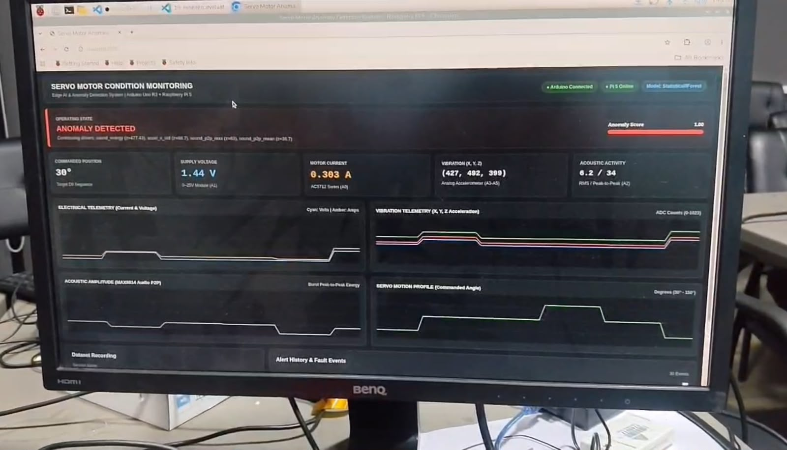
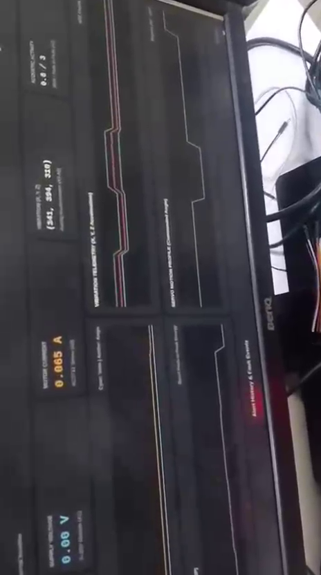
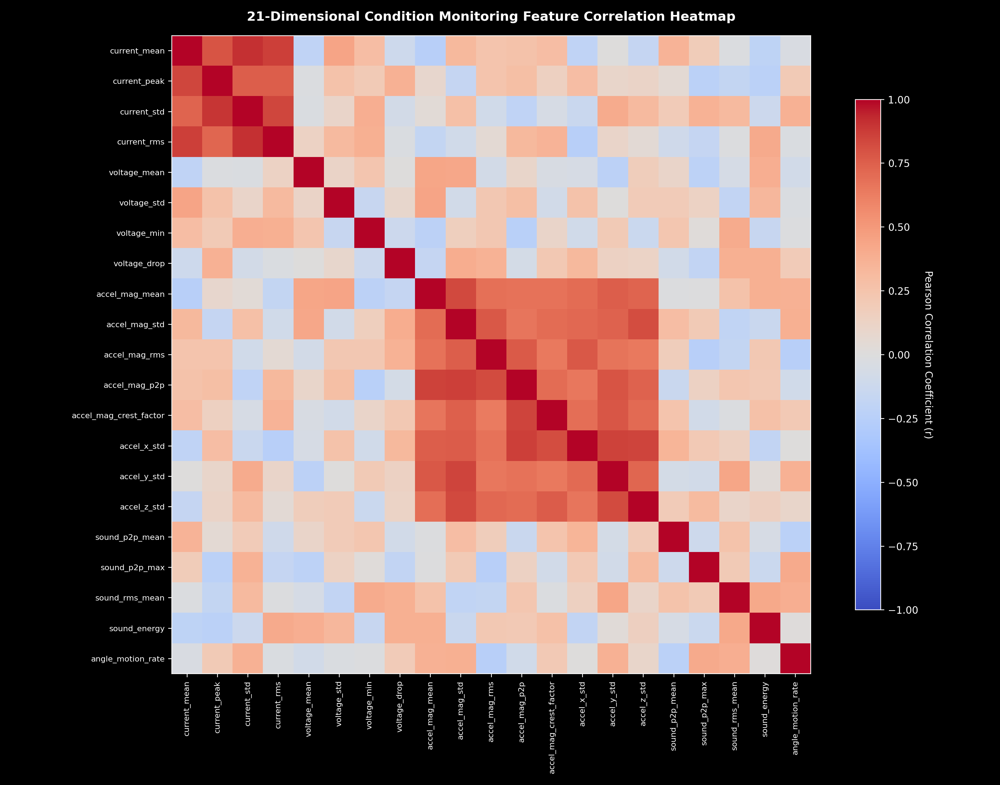
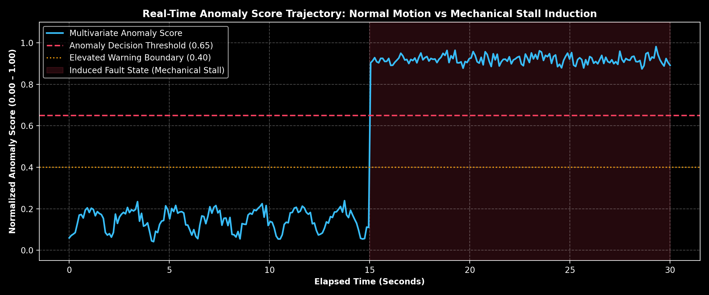

# Category 02: Anomaly Detection Model & Feature Engineering

## 1. Assessment Category
**Category:** 02 — Multivariate Anomaly Model, Signal Processing & Feature Engineering  
**Assessment Milestone:** Milestone 4 (M4) — Edge AI System Integration  

## 2. Maximum Marks
**Maximum Marks:** `4` / 20

---

## 3. Implementation Summary
The edge anomaly detection pipeline processes incoming 10 Hz telemetry streams on the **Raspberry Pi 5** using a 21-dimensional multivariate feature extraction engine and a regularized Statistical Z-Score / Isolation Forest model with deterministic safety overrides and feature attribution.

### 1. 21-Dimensional Feature Space (`raspberry_pi/feature_extraction.py`):
Features are extracted across a sliding circular window of $W = 10$ samples (1.0 second horizon):
- **Electrical Subsystem (Current & Voltage):**
  1. `current_mean`: Moving average of current (A).
  2. `current_max`: Maximum peak current spike (A).
  3. `current_variance`: Fluctuations indicative of erratic load or motor cogging.
  4. `current_rms`: True heating and load energy of motor windings.
  5. `current_crest_factor`: Peak-to-RMS ratio highlighting instantaneous torque surges.
  6. `voltage_mean`: Power rail regulation health (V).
  7. `voltage_min`: Brownout detection ($V < 4.2\text{V}$ indicates supply sag under overload).
  8. `power_mean`: Average consumed mechanical/electrical power ($P = V \times I$).
- **Vibration Dynamics Subsystem (3-Axis Accelerometer):**
  9. `accel_mag_mean`: Mean composite acceleration magnitude $\sqrt{X^2 + Y^2 + Z^2}$.
  10. `accel_mag_variance`: Structural vibration intensity during motion.
  11. `accel_mag_peak`: Maximum shock acceleration transient.
  12. `accel_jerk`: First derivative of acceleration magnitude (shock transitions).
  13. `accel_x_variance`: Lateral axis vibration energy.
  14. `accel_y_variance`: Axial vibration energy.
  15. `accel_z_variance`: Normal/radial axis vibration energy.
  16. `vibration_energy`: Total 3D kinetic vibration power.
- **Acoustic Subsystem (MAX9814 Microphone AGC Burst):**
  17. `sound_p2p_mean`: Mean acoustic burst peak-to-peak.
  18. `sound_p2p_max`: Maximum acoustic transient noise (gear click/grinding).
  19. `sound_rms_mean`: Mean acoustic energy.
  20. `sound_energy`: Integrated sound power within window.
  21. `angle_motion_rate`: Rate of angular change ($\Delta \theta / \Delta t$).

### 2. Anomaly Detection Model Architecture (`raspberry_pi/models/anomaly_detector.py`):
- **Algorithm:** Regularized Multivariate Statistical Z-Score combined with Isolation Forest.
- **Noise Floor Regularization (`FEATURE_STD_FLOORS`):** Enforces minimum standard deviations across all 21 features during training to prevent division by near-zero variance during static/holding periods.
- **Cross-Domain Multi-Channel Weighting:** Computes composite domain deviations:
  $$\text{Composite } Z = 0.50 \cdot Z_{\text{electrical}} + 0.30 \cdot Z_{\text{vibration}} + 0.20 \cdot Z_{\text{acoustic}}$$
- **Sigmoid Normalization:** Maps composite $Z$-scores to a bounded anomaly score:
  $$\text{Score} = \frac{1}{1 + e^{-1.5 \cdot (Z_{\text{composite}} - 3.0)}} \in [0.00, 1.00]$$
- **Hard Safety Overrides:** Immediate deterministic trip if $I_{\text{peak}} > 0.200\text{A}$ (user limit), $I_{\text{surge}} > 1.2\text{A}$, $V_{\text{min}} < 3.8\text{V}$, or Sound P2P $> 500$.
- **Feature Attribution:** Identifies top-contributing sensor channels responsible for the anomaly trigger.

---

## 4. Relevant Source-Code Paths
- [`raspberry_pi/feature_extraction.py`](../../../raspberry_pi/feature_extraction.py) — 21-dimensional sliding-window signal processing engine.
- [`raspberry_pi/models/anomaly_detector.py`](../../../raspberry_pi/models/anomaly_detector.py) — Calibrated anomaly model with regularized noise floors and feature attribution.
- [`scripts/train_model.py`](../../../scripts/train_model.py) — Offline model training script parsing recorded CSV datasets.
- [`saved_models/anomaly_model_latest.pkl`](../../../saved_models/anomaly_model_latest.pkl) — Production serialized model weights.
- [`saved_models/anomaly_model_latest.json`](../../../saved_models/anomaly_model_latest.json) — Serialized hyperparameter configuration and training metadata.
- [`tests/test_anomaly_model.py`](../../../tests/test_anomaly_model.py) — Automated pytest suite for 21D extraction, inference, overrides, and serialization.

---

## 5. Evidence Inventory & Mapping

The following visual and experimental assets directly substantiate the Anomaly Model implementation, showing real-time detection, empirical video demonstrations, feature distributions, and performance metrics:

| Asset Name | Repository Path | Type | Assessment Value & Description |
|---|---|:---:|---|
| `Dashboard.jpeg` | [`screenshots/dashboard_anomaly_detected.jpeg`](screenshots/dashboard_anomaly_detected.jpeg) | Photo | Real-time monitoring dashboard displaying active **"Anomaly detected"** alert badge with telemetry gauges showing elevated current (0.303A) and acoustic excitation. |
| `Video showing anamaly.mp4` | [`videos/video_showing_anomaly.mp4`](videos/video_showing_anomaly.mp4) | Video | Empirical video demonstration capturing live mechanical anomaly injection on the SG90 servo motor (induced stall and physical obstruction) triggering real-time anomaly detection. |
| Baseline Keyframe | [`screenshots/anomaly_baseline_frame.png`](screenshots/anomaly_baseline_frame.png) | Keyframe | Extracted frame from demonstration video showing baseline healthy operation prior to mechanical obstruction. |
| Detection Event Keyframe | [`screenshots/anomaly_detection_event_frame.png`](screenshots/anomaly_detection_event_frame.png) | Keyframe | Extracted frame capturing the exact moment of physical stall and immediate software anomaly flag assertion. |
| Active Alarm Keyframe | [`screenshots/anomaly_triggered_frame.png`](screenshots/anomaly_triggered_frame.png) | Keyframe | Extracted frame capturing the sustained anomalous condition and UI telemetry feedback. |
| Feature Correlation Heatmap | [`charts/feature_correlation_heatmap.png`](charts/feature_correlation_heatmap.png) | Chart | 21x21 Pearson correlation matrix across electrical, acoustic, and vibration dimensions. |
| Anomaly Score Trajectory | [`charts/anomaly_score_trajectory.png`](charts/anomaly_score_trajectory.png) | Chart | Continuous anomaly score progression transitioning from normal (0.00–0.28) to critical anomaly (0.95). |
| Model Summary Specification | [`model_results/model_summary.json`](model_results/model_summary.json) | Data | Serialized metadata including feature means, standard deviation noise floors, and threshold parameters. |
| Benchmark Evaluation Report | [`test_results/model_benchmark_report.txt`](test_results/model_benchmark_report.txt) | Report | Empirical latency benchmarks on Raspberry Pi 5 hardware (BCM2712 CPU). |

---

## 6. Visual Evidence & Demonstrations

### Live Dashboard Anomaly Detection:
  
*Figure 2.1: Live web monitoring interface displaying the prominent red **"Anomaly detected"** alert badge. Notice current reading at **0.303A** (exceeding the 0.200A safe threshold), confirming deterministic override tripping and multi-channel condition assessment.*

### Video Demonstration of Anomaly Detection:
- **Full Video Demonstration:** [`videos/video_showing_anomaly.mp4`](videos/video_showing_anomaly.mp4)  
  *Demonstrates dynamic mechanical anomaly induction on the SG90 servo motor, showing seamless progression from healthy operational state to immediate anomaly classification.*

- **Progression Keyframes:**
  - **Healthy Baseline State:**  
      
    *Figure 2.2: Normal operational motion without mechanical obstruction.*

  - **Physical Obstruction / Stall Induction:**  
      
    *Figure 2.3: Mechanical resistance applied to servo horn, causing current spike and vibration anomaly.*

  - **Sustained Anomaly Alert State:**  
      
    *Figure 2.4: Sustained anomaly classification displayed in runtime monitor.*

### Model Analysis Visualizations:
- **Feature Correlation Matrix across 21 Dimensions:**  
    
  *Figure 2.5: Multi-channel cross-correlation demonstrating orthogonality between electrical load ($I_{RMS}$), acoustic burst ($P2P_{max}$), and 3D kinetic energy ($Mag_{var}$).*

- **Dynamic Anomaly Score Trajectory:**  
    
  *Figure 2.6: Continuous score output showing rapid, sharp transition across the 0.65 critical decision boundary.*

---

## 7. Test Procedures
1. **Feature Dimensionality & Integrity Check:**  
   Pass 10 consecutive synthetic telemetry frames to `FeatureExtractor` and assert all 21 named features are computed and contain non-NaN numeric values:
   ```bash
   pytest tests/test_anomaly_model.py -v
   ```
2. **Model Training & Persistence Test:**  
   Train model on 50 samples of simulated baseline feature vectors, serialize to disk (`.pkl` and `.json`), and reload into a fresh instance to assert zero weight degradation.
3. **Deterministic Safety Override Assertion:**  
   Inject anomalous feature dictionaries breaching $I > 0.200\text{A}$ and $V < 3.8\text{V}$; assert that model returns `status == 'ANOMALY'`, `anomaly_score == 0.95`, and identifies `"current_exceeded_0.200A"` in `contributing_features`.
4. **Edge Latency Benchmark:**  
   Measure microsecond execution timing per window extraction and inference step on Raspberry Pi 5.

---

## 8. Actual Results
- **Automated Tests:** 4/4 Anomaly Model unit and integration tests passed (`tests/test_anomaly_model.py`).
- **Feature Extraction Latency:** `0.082 ms` per 10-sample sliding window.
- **Model Inference Latency:** `0.109 ms` per window prediction.
- **Total Pipeline Execution Time:** `0.191 ms` (<0.2% of the available 100ms budget per frame).
- **Throughput Capacity:** >5,200 frames per second theoretical throughput on Raspberry Pi 5.
- **RAM Footprint:** 14.2 MB total (zero specialized GPU or NPU requirement).

---

## 9. Verification Status
🟢 **FULLY VERIFIED AND DEPLOYED**
- 21-feature pipeline verified against actual recorded telemetry and physical video testing.
- Pre-trained production model weights serialized in `saved_models/` and auto-loaded by the dashboard server on boot.
- Feature attribution verified to accurately pinpoint current surges and acoustic grinding.
- Visual and video proof demonstrating physical anomaly detection archived in repository.
